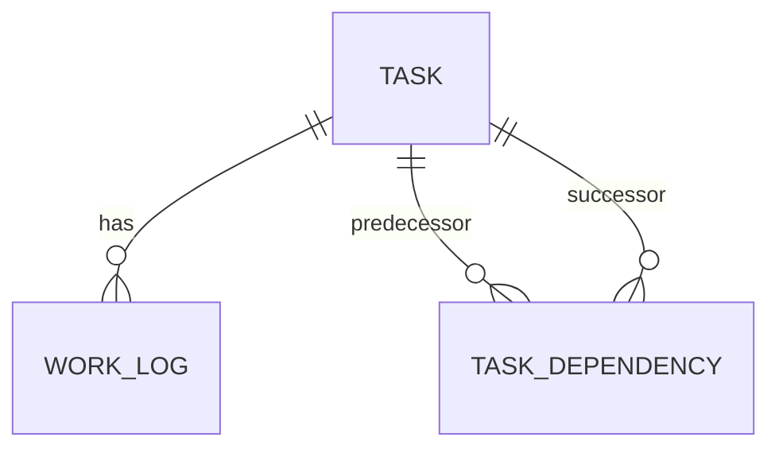

# データモデル

- 対象: Must M1-M3、Should S1-S3
- 方針: [ADR-003](../adr/ADR-003-data-model-and-api.md)に基づく。Mustを先に実装し、その後Should S1〜S3を実装する。

## エンティティと関連

- 1つのタスクは0件以上の実績記録を持つ。
- タスク間の依存関係は、先行タスクと後続タスクを結ぶ有向関係として別に保持する。
- 依存関係は自己参照であり、1つのタスクに複数の先行・後続タスクを設定できる。
- 担当者は自由入力のため、参加者マスタや認証ユーザーとの外部キーは設けない。

## テーブル定義

### `tasks`

| カラム | PostgreSQL型 | 制約・初期値 | 対象・用途 |
|---|---|---|---|
| `task_id` | `BIGINT GENERATED BY DEFAULT AS IDENTITY` | 主キー | 全条件。タスクを一意に識別する |
| `task_name` | `VARCHAR(100)` | NOT NULL。空文字・空白のみを拒否 | M1/M2。最大100文字 |
| `description` | `TEXT` | NULL可 | M1。未入力可 |
| `due_date` | `DATE` | NOT NULL | M1/M2。期限日 |
| `deleted_at` | `TIMESTAMPTZ` | NULL可 | M3。NULL以外は論理削除済み |
| `status` | `VARCHAR(16)` | S2実装時にNOT NULL、初期値`NOT_STARTED`。`NOT_STARTED`／`IN_PROGRESS`／`COMPLETED`のみ | S2。画面表示では「未着手」／「実行中」／「完了」 |
| `assignee_name` | `TEXT` | NULL可 | S2。自由入力。NULLまたは空欄は「未割当」 |
| `estimated_minutes` | `NUMERIC` | NULL可。設定時は0以上の整数 | S1。タスクごとの見積り分数 |

### `work_logs`

| カラム | PostgreSQL型 | 制約・初期値 | 対象・用途 |
|---|---|---|---|
| `work_log_id` | `BIGINT GENERATED BY DEFAULT AS IDENTITY` | 主キー | S1。実績記録を一意に識別する |
| `task_id` | `BIGINT` | NOT NULL、`tasks.task_id`への外部キー | S1。実績の対象タスク |
| `work_date` | `DATE` | NOT NULL | S1。実績日。未来日はアプリケーション側で拒否する |
| `minutes` | `NUMERIC` | NOT NULL、0以上の整数 | S1。実績分数。製品上の上限は設けない |

- タスクごとの実績合計は`work_logs.minutes`の合計から求め、別カラムには保存しない。
- 見積りの変更は`work_logs`を変更しない。
- `task_id`の外部キーは物理削除を制限する。通常のタスク削除は論理削除とする。

### `task_dependencies`

| カラム | PostgreSQL型 | 制約・初期値 | 対象・用途 |
|---|---|---|---|
| `predecessor_task_id` | `BIGINT` | 主キーの一部、`tasks.task_id`への外部キー | S2/S3。先行タスク |
| `successor_task_id` | `BIGINT` | 主キーの一部、`tasks.task_id`への外部キー | S2/S3。後続タスク |

- 複合主キー`(predecessor_task_id, successor_task_id)`により同一関係の重複を防ぐ。
- `predecessor_task_id <> successor_task_id`を制約し、自己依存を防ぐ。
- 循環依存は単一行のDB制約では判定できないため、登録・編集時にアプリケーション側で検証する。
- タスクを論理削除するときは、そのタスクを先行または後続とする関係を同一トランザクションで削除する。

## 並列作業状態

並列作業状態は保存せず、タスク一覧を返す際にステータスと依存関係から判定する。

| タスクの状態・依存関係 | 表示する状態 |
|---|---|
| 完了済み | 完了 |
| 実行中 | 実行中 |
| 未着手で先行タスクなし | 並列作業可能 |
| 未着手で先行タスクがすべて完了 | 並列作業可能 |
| 未着手で未完了の先行タスクがある | 並列作業不可 |
| 依存関係を取得できない、または不正な関係がある | 判定不能 |
| 論理削除済み | 通常一覧に含めない |

状態は最新のタスク情報と依存関係から再計算し、古い判定結果を最新状態として返さない。

## 削除時の扱い

- タスク削除は`deleted_at`を設定する論理削除とする。
- 論理削除済みタスクは通常の一覧・依存関係判定から除外する。
- 実績記録は保持する。
- 関連する依存関係は削除する。

## 受け入れ条件との対応

| 条件 | データモデル上の対応 | API／アプリケーション上の対応 |
|---|---|---|
| M1-02、M1-05、M2-06 | `task_name`と`due_date`をNOT NULLにする | 未入力・空白のみのタスク名を拒否し、エラーを返して保存しない |
| M1-06、M2-07 | `task_name`を`VARCHAR(100)`にする | 100文字を超える入力を拒否する |
| M1-07、M2-08 | 期限日を`DATE`として保持する | 実在しない日付や不正な形式を拒否し、保存しない |
| M3-02、M3-04 | `deleted_at`による論理削除 | 削除を確定したタスクを一覧から除外する |
| M3-03 | 該当なし | 削除成功後の完了メッセージを画面に表示する |
| S1-02 | 見積りと実績記録を別に保持する | 見積りの更新で実績記録や他タスクを変更しない |
| S1-03〜S1-07 | 日付付き実績を個別に保存し、合計は実績から算出する | 記録・編集、合計の返却、見積りと実績の区別表示、再表示時の値維持を行う |
| S1-08、S1-09 | 分数を0以上の整数として扱い、製品上の上限を設けない | 不正値を拒否し、理由を示して保存済みデータを変更しない |
| S1-10 | 実績日を`DATE`として保持する | 未入力・実在しない日付・未来日を拒否する |
| S1-11、S1-12 | 直接担保するスキーマ制約なし | 登録・編集をトランザクションで行い、失敗時は部分更新せず、対象タスクがなければ404として他データを変更しない |
| S2-02〜S2-09、S2-13 | ステータスと依存関係を保持し、並列作業状態は保存せず算出する | 最新のステータス・依存関係から状態を再判定して返す |
| S2-10、S2-14〜S2-16 | 論理削除、NULL可の担当者、依存関係を保持する | 削除済み・未割当・不正または取得不能な関係をそれぞれ適切に表示する |
| S3-1〜S3-10 | 有向関係を複合主キーで保持し、自己依存と重複を制約する | 循環・存在しないタスクを検証し、一覧・編集・解除と失敗時の整合性を扱う |

## 実装フェーズ

- **Must:** `tasks`のタスク名・説明・期限日・論理削除を実装する。
- **Should S1:** Must完了後に`estimated_minutes`と`work_logs`を実装する。
- **Should S2/S3:** Must完了後に`status`、`assignee_name`、`task_dependencies`と状態判定を実装する。
- Should S1〜S3は採用済みのデータモデルと[API契約](./api-contract.md)に沿って実装し、必要なFlywayマイグレーションを追加する。個別の実装順・担当者・見積りはWBSで決定する。
